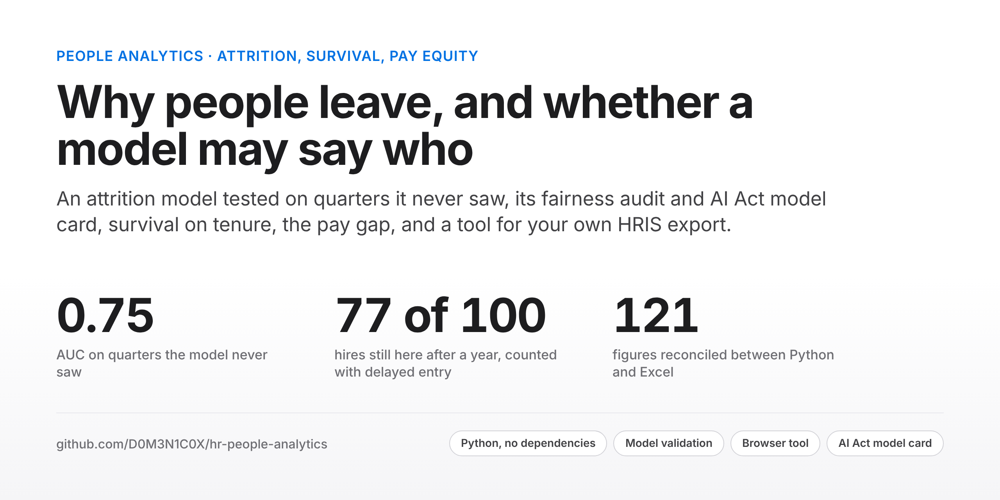
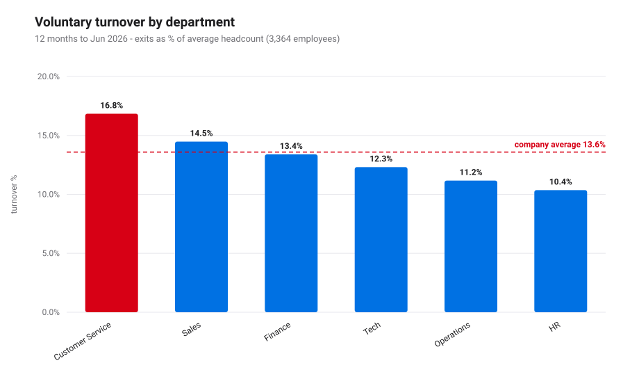
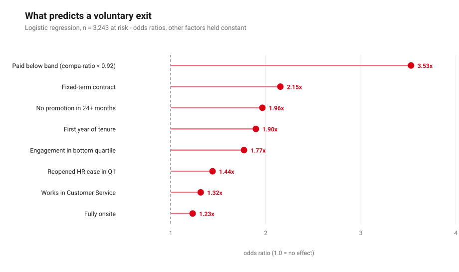
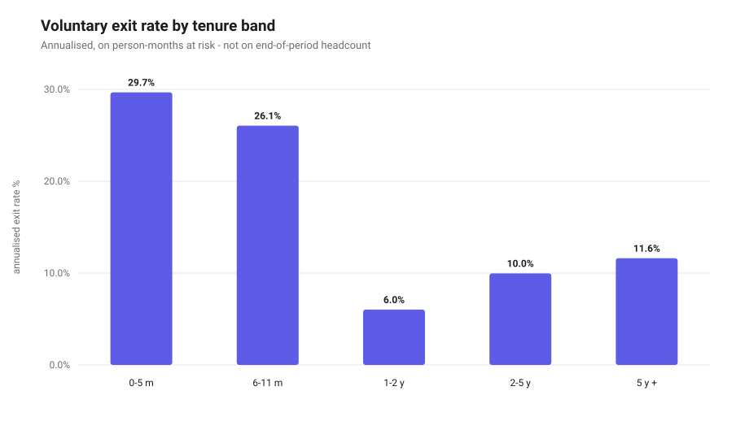
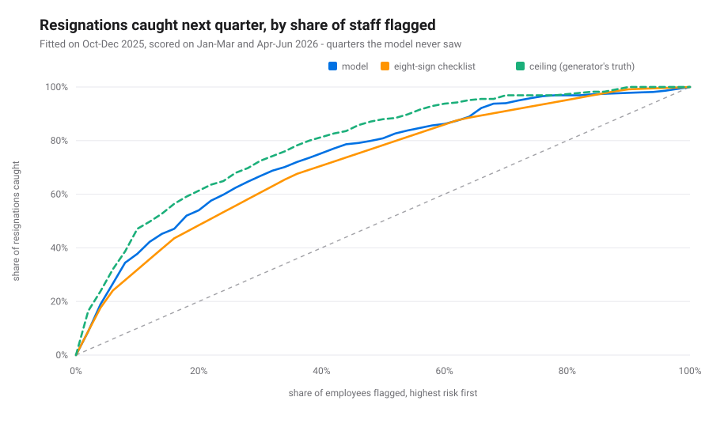
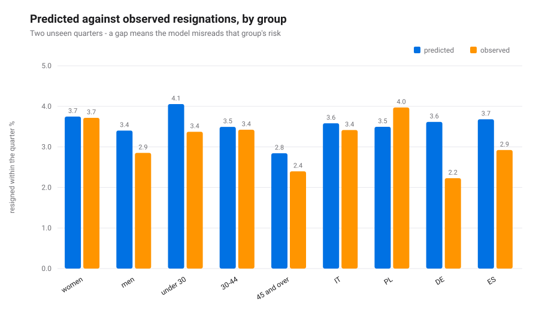
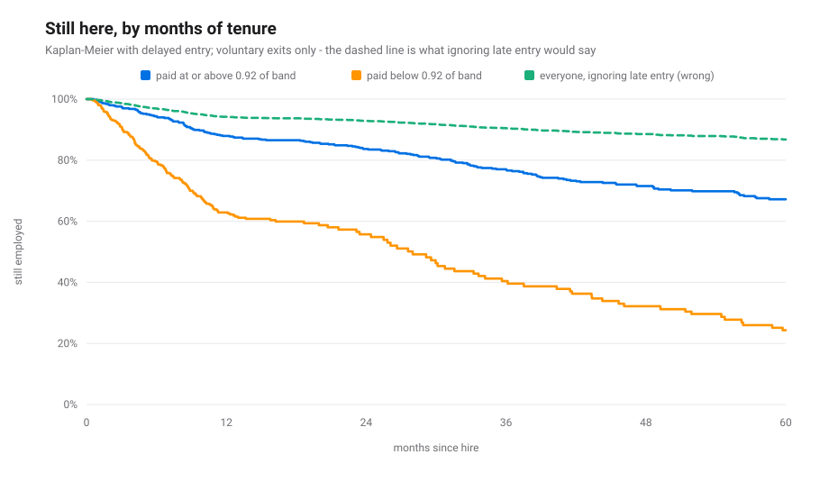
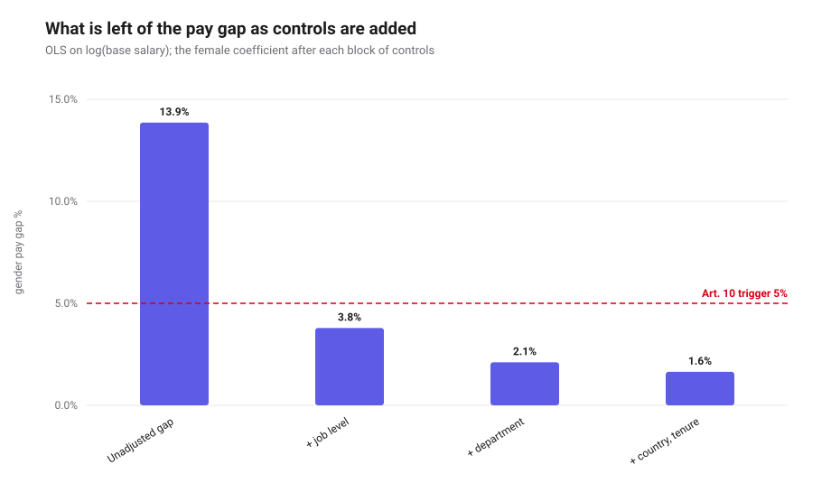
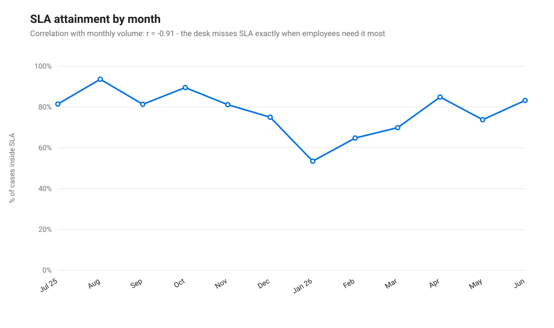

<picture>
  <source media="(prefers-color-scheme: dark)" srcset="site-assets/cover-dark.png">
  
</picture>

<p align="center">
  <a href="https://d0m3n1c0x.github.io/hr-people-analytics/"><b>Read the report</b></a> ·
  <a href="https://d0m3n1c0x.github.io/hr-people-analytics/tool/"><b>Try it on your own file</b></a> ·
  <a href="docs/model_card.md">Model card</a> ·
  <a href="deliverables/people_analytics.xlsx">The workbook</a> ·
  <a href="reports/findings.md">The report in Markdown</a> ·
  <a href="sql/">The SQL layer</a>
</p>

<p align="center">
  <a href="https://github.com/D0M3N1C0X/hr-people-analytics/actions/workflows/ci.yml"></a>
  
  
  
</p>

## Why this matters

Three questions every People function has to answer with numbers: *why are people leaving, is our pay defensible,
and is the HR service actually working.* They are answered here end to end on a 4,000-employee European
organisation, as an HR analytics team would hand them to leadership: data model, SQL warehouse, statistics, charts
and a written report with costed recommendations. The same organisation feeds the pay transparency kit, the
equal-value pay ranges and the workforce cost model in this portfolio.

> **The data is synthetic**, generated with a fixed seed by [`src/generate_data.py`](src/generate_data.py).
> No real employee data is used anywhere. The methods, the metric definitions and the way the
> findings are argued are what this repository is for.

---

## The headline findings

| | |
|---|---|
| **Voluntary turnover is 13.6%**, but it is not spread evenly — Customer Service runs at 16.8% and produces 36% of all exits on 30% of the workforce. | Employees paid **below 0.92 compa-ratio have 3.53x the odds of resigning**, holding contract type, tenure, engagement and department constant: in the model, about **28% a year against 10%** without the gap. |
| **The gender pay gap is 15.4% unadjusted and 1.6% like-for-like.** On the log-pay model, whose raw gap is 13.9%, 88% of it is structural, not a pay-for-the-same-job problem. | **10 of 27 worker categories** cross the modelled 5% pay-gap screen. The dataset does not model employer justification or remedy within six months, so it cannot establish that a joint pay assessment is required. |
| **SLA attainment is 76.4% against a 90% target**, and it collapses to 53% in January — the correlation between monthly volume and attainment is **r = −0.91**. | Cases that miss SLA **and** get reopened average **2.27 CSAT** against **4.69** for a clean resolution — and those reopened cases predict resignations nine months later. |
| **Tested on quarters it never saw, the attrition model keeps an AUC of 0.75** (0.72-0.79), and its top 10% of scores catches **38%** of the next quarter's resignations. | Counting the same eight warning signs gets **0.72**; the generator's own truth, latent traits included, gets **0.80**. The model closes **84%** of the gap between chance and that ceiling. |
| **The fairness audit finds the model's real flaw:** it over-reads Germany, **3.6%** predicted against **2.2%** resigning, **2.9** standard errors out, because country is not an input. | Of flagged people, **88%** stay. The [model card](docs/model_card.md) answers, as the provider, the 14 questions the [AI Act register](https://github.com/D0M3N1C0X/ai-act-hr-readiness-kit) asks of this high-risk system. |





---

## What this project demonstrates

| HR domain | Analytics | Engineering |
|---|---|---|
| Turnover metrics defined properly (average headcount, voluntary vs involuntary, regretted attrition) | Logistic regression with a feature window / outcome window split to avoid look-ahead bias | Zero dependencies — stdlib Python only, runs anywhere |
| Cost of attrition with stated, changeable assumptions | Survival-style hazard on person-months at risk, not end-of-period headcount | Deterministic pipeline: same seed, same numbers, verified in CI |
| EU Pay Transparency Directive (2023/970): Art. 9 reporting items, Art. 10 joint pay assessment trigger | Nested OLS on log salary to separate structural from like-for-like pay gaps | SQL warehouse (SQLite) with CTEs, window functions and a view |
| HR service-desk operations: SLA, FCR, reopen rate, CSAT, deflection and capacity planning | Welch tests and p-values reported, small samples flagged rather than spun | Charts generated as SVG from scratch — no plotting library |
| Recommendations written for a leadership audience, not a technical one | Statistics implemented from first principles in [`src/statsx.py`](src/statsx.py) | Every figure and number in the report is reproduced by one command |
| Retention as a workforce-planning curve: how many of a hundred hires are still here after one, two, three years | Survival analysis from scratch: Kaplan-Meier with delayed entry, log-rank, Cox with Breslow ties, a time-varying effect | Cox fitted in one backward pass over the risk sets, tested against the log-rank identity |
| What a risk score may and may not be used for, written as the AI Act's instructions for use | Out-of-time validation: AUC with intervals, capture, calibration, a checklist baseline and the data's own ceiling | The ceiling rebuilt from the generator in memory, so the benchmark cannot drift from the data |
| The core figures as an Excel workbook an HR team can audit cell by cell | Turnover, warning signs and the Article 9 and 10 pay figures as live formulas | 121 figures reconciled with Python through [excel-twin](https://github.com/D0M3N1C0X/excel-twin), recalculated by LibreOffice in CI |
| A tool an HR team can run on its own export: teams, never lists of names | The same definitions in JavaScript, checked against Python on 1,530 values in 31 datasets | Runs in the browser on the user's file, nothing uploaded; English and Italian |
| Fairness by sex, age, country and working time, and what an audit cannot see | Calibration by group with the gap in standard errors; catch and false-flag rates at one cut | The model card is generated from the same code, so it cannot quote a stale number |

---

## Try it on your own file

**[The retention check](https://d0m3n1c0x.github.io/hr-people-analytics/tool/)** runs the same analysis on
any HRIS export, in the browser: one row per employee with hire date, leaving date and department is
enough, and pay, contract and promotion columns add the rest. It gives turnover by department, how
many hires are still there after one, two and three years (with delayed entry, as above), what goes
with resigning, warning signs team by team, and the pay gap, and exports them to Excel. Columns are
matched by name in English, Italian, Polish, German and Spanish.

What it does not do is by design: it never lists people, it hides teams under five, and it reads no
engagement scores. The file stays on the computer. Its engine, [`web/engine.js`](web/engine.js), is
checked on every change against [`src/tool_reference.py`](src/tool_reference.py) on this repository's
data and 30 random files, 1,530 values in all.

## The workbook

[`deliverables/people_analytics.xlsx`](deliverables/people_analytics.xlsx) holds the report's core figures
as live formulas over the 4,000 employee rows, for anyone who would rather audit a number by clicking on
it: voluntary turnover by department from twelve month-end headcounts, the warning signs the attrition
model is built on (who had each, who resigned), the Article 9 pay-gap items and the 36 department x level
categories with the Article 10 rules. Its Reconciliation sheet sets each of 121 figures against the value
Python computed, and CI recalculates the file with LibreOffice and fails if one disagrees, through
[excel-twin](https://github.com/D0M3N1C0X/excel-twin), the same check the rest of the portfolio uses.

The pipeline stays standard-library only; the workbook's builder is the one place with packages:

```bash
pip install -r tools/requirements.txt
python3 tools/build_workbook.py
excel-twin recalc deliverables/people_analytics.xlsx build/ && excel-twin check build/people_analytics.xlsx
```

## Run it

```bash
python3 src/run_all.py
```

That regenerates the data, rebuilds the SQLite warehouse, runs the three analyses and the
out-of-time test, the fairness audit and the survival analysis, writes 18 charts and assembles [`reports/findings.md`](reports/findings.md) plus a self-contained
[`reports/findings.html`](reports/findings.html) with every chart inlined. It takes a few
seconds and needs **no packages installed** — Python 3.10 or newer and nothing else.

```bash
python3 src/run_sql.py
```

runs the SQL layer against `data/hr.db` and prints the results as tables.

```bash
python3 -m unittest discover -s tests
node tests/js/check_engine.mjs
```

run the tests, also with no packages installed: the second checks the browser tool against Python.

---

## What's inside

```
├── src/
│   ├── generate_data.py          synthetic HR data with documented, planted effects
│   ├── hrlib.py                  shared loading + HR metric definitions
│   ├── statsx.py                 OLS, logistic regression, Welch test - pure stdlib
│   ├── viz.py                    small SVG charting library
│   ├── build_db.py               CSV -> SQLite warehouse
│   ├── run_sql.py                runs the sql/ queries and prints results
│   ├── analysis_attrition.py     module 1
│   ├── analysis_pay_gap.py       module 2
│   ├── analysis_service_desk.py  module 3
│   ├── analysis_validation.py    module 1b: the attrition model on quarters it never saw
│   ├── analysis_fairness.py      module 1c: who the model reads right and who it does not
│   ├── analysis_survival.py      module 1d: how long people stay, on tenure time
│   ├── build_model_card.py       docs/model_card.md, from the same numbers
│   ├── tool_reference.py         the browser tool's calculations, and the cases it is checked on
│   ├── build_report_html.py      findings.md -> one self-contained HTML file
│   └── run_all.py                the whole pipeline, one command
├── sql/                          analysis queries: CTEs, window functions, cross-table joins
├── data/                         generated CSVs + data dictionary
└── reports/
    ├── findings.md               the written report
    ├── findings.html             the same report as one shareable file
    └── figures/                  18 SVG charts
docs/
    └── model_card.md             instructions for use, in the AI Act register's order
web/                              the retention check: index.html, app.js, engine.js, shared design
tests/js/check_engine.mjs         recomputes every Python case in JavaScript
tools/build_workbook.py           the Excel twin (openpyxl and excel-twin: the only packages, and only here)
deliverables/people_analytics.xlsx  121 figures as formulas, reconciled with Python
```

---

## The three modules

### 1. Attrition & retention

Where the losses are, when in the lifecycle they happen, what predicts them, and what they cost.
The driver model is fitted on a **feature window** (Jul–Sep 2025) with the outcome measured in
the **following nine months**, so predictors are always observed before the exit they predict and
every employee carries the same exposure.



The risk curve is not a straight line down: 27.9% annualised in the first year, 6.0% for people
between one and two years, then rising again as promotion stagnation sets in. Two different
problems, two different fixes.

The model also does something useful to the department story — once pay position, contract type
and tenure are controlled for, the Customer Service effect stops being significant. That
department does not have a culture problem; it has a composition problem.

**Does it predict, or only explain?** A model read on the people it was fitted to always looks
good. So the same eight terms are fitted once on the quarter from 1 October 2025 and scored on the
next two quarters, people and months the model never saw, with every predictor frozen on the
scoring date. Out of sample the AUC is 0.75 against 0.77 in sample, the probabilities hold (3.6%
predicted, 3.3% observed, calibration slope 0.96), and flagging the top 10% catches 38% of the
next quarter's resignations. Two reference points keep that honest: a checklist that just counts
the eight warning signs reaches 0.72, so most of the value is in knowing which signs to watch; and
the generator's own hazard, which knows a latent trait no HRIS holds, reaches 0.80, the most any
model built on this data could get.



Even the best tenth of scores misses most resignations, and most people it flags stay. A score
like this can decide where a manager's next stay conversation goes, never anything about the
person scored.

**Is it fair, and may it be used at all?** In the [AI Act register](https://github.com/D0M3N1C0X/ai-act-hr-readiness-kit)
built for the same organisation, this model is system S07: high-risk, and built in-house, so the
employer is its provider. Its [model card](docs/model_card.md) answers, as a provider would, the
questions the register sends every supplier: accuracy, performance by group, oversight, logs,
explanations, what counts as a significant change. The audit behind it breaks the unseen quarters
down by sex, age, country and working time. It finds the model's real flaw: country of work is not
an input, so Germany is over-read (3.6% predicted, 2.2% resigning) and Poland under-read. Fixing it
is version 1.1, and adding an input is a significant change under the AI Act, so the provider's
duties have to be in place first. The card also rules out pay, counter-offers, promotion and
dismissal as uses, and flags the engagement input: an individual survey score breaks the
confidentiality most surveys promise.



**How long do people stay?** A workforce plan needs the curve, not the odds: of a hundred people
hired, how many are still here after one, two, three years. Survival analysis on tenure time answers
it: 77% after a year, 65% after three. The data covers twelve calendar months, so someone hired in
2019 only enters observation with six years of tenure; counting everyone from their first day would
say 94% survive the first year, crediting the organisation with every early leaver it never saw.
Over the first three years, people paid below 0.92 of band stay 22.4 months on average against 31.3
for the rest, and a Cox model puts the pay effect at 3.10 times the resignation hazard, the same in
the first year as after it.



### 2. Pay equity, EU Pay Transparency Directive

Directive (EU) 2023/970 had to be transposed by **7 June 2026**; employers of this size report
by **7 June 2027 and every year thereafter** (Art. 9(2)), on the preceding calendar year.
This analysis runs on a snapshot of active employees at 30 June 2026 — the shape of the
exercise, not a statutory submission, and not legal advice. The module produces
the Article 9 reporting items and identifies the categories that would trip the Article 10
5% joint-pay-assessment trigger.



Adding controls one block at a time is the point: on the log-pay model, 13.9% raw (15.4% on
arithmetic means), 3.8% once job level is held constant, 1.6% fully adjusted. The remediation bill for the residual gap is small. Changing who
gets promoted — women are 38% of the top pay quartile and 60% of the bottom one — is the work
that actually moves the headline number.

### 3. HR service-desk performance

28,470 cases over twelve months: volume, seasonality, SLA, first-contact resolution, reopens
and CSAT, ending in three costed recommendations.



Capacity is flat, demand is not. The desk misses its promise precisely in the months when the
questions are about pay, tax and contracts.

---

## The SQL layer

Every headline number can also be produced in SQL — the same analysis in the language most HR
data lives in. From [`sql/03_service_desk.sql`](sql/03_service_desk.sql), the cross-table
question that links the two datasets:

```sql
WITH case_history AS (
    SELECT employee_id, SUM(reopened) AS reopened_cases
    FROM hr_cases
    WHERE created_date < '2025-10-01'          -- feature window only, no look-ahead
    GROUP BY employee_id
)
SELECT CASE WHEN COALESCE(h.reopened_cases, 0) = 0 THEN 'no reopened case'
            ELSE 'reopened case' END                                    AS service_experience,
       COUNT(*)                                                         AS employees,
       ROUND(100.0 * SUM(CASE WHEN e.exit_type = 'Voluntary'
                               AND e.exit_date >= '2025-10-01'
                              THEN 1 ELSE 0 END) / COUNT(*), 1)         AS exit_pct
FROM employees e
LEFT JOIN case_history h ON h.employee_id = e.employee_id
WHERE e.hire_date < '2025-10-01'
  AND (e.exit_date IS NULL OR e.exit_date >= '2025-10-01')
GROUP BY service_experience;
```

The queries cover recursive CTEs for the month series, `NTILE(4)` for pay quartiles, running
totals for Pareto analysis, `RANK()` for department risk and moving averages for case volume.

---

## Method notes

- **Turnover** is exits over the period divided by *average* headcount, not closing headcount,
  and voluntary is reported separately from involuntary.
- **Tenure risk** uses person-months at risk as the denominator, so employees who move between
  tenure bands during the year are counted where they actually were.
- **Odds ratios describe association, not causation.** They rank risk and point at where to
  look; the report says so wherever a number could be read as a promise.
- **Assumptions are stated and centralised**: replacement cost at 30% of annual salary, 40
  minutes of agent handling effort per case, 1,600 productive hours per FTE. Change them in
  `src/hrlib.py` or `src/analysis_service_desk.py` and every dependent number updates.
- **Small samples are flagged, not spun.** Pay-gap categories under ~50 employees carry wide
  intervals and are labelled as such in the report.
- **What an intervention is worth comes from the model's own predictions.** For each employee below
  band, the predicted chance of resigning with the gap and without it, everything else held equal.
  An odds ratio is not a risk ratio once exits are common, so it is not applied to a base rate.
- **The statistics are tested against closed forms**: a logit with one binary predictor must return
  the log odds ratio of its 2×2 table and that ratio's standard error; OLS must match the simple
  regression formula. Tests also check that every headline figure in this README is in the report.

**Correction, 8 October 2026.** The intervention used to multiply the company-wide exit rate by
(1 − 1/OR), which treats an odds ratio as a risk ratio and applies the wrong base rate. Computed from
the model's predictions it avoids about 128 resignations a year, not 69, and recovers 52% of the
uplift bill, not 28%. The conclusion stands: a blanket uplift does not pay for itself.

Full write-up of methods and limits at the end of [`reports/findings.md`](reports/findings.md).

## Data

Two linked tables — 4,000 employees and 28,470 HR cases over the twelve months to 30 June 2026.
Column-by-column definitions, and an honest list of the effects deliberately planted in the
generator, are in [`data/README.md`](data/README.md).

## About

Built by **Domenico Perroni** — HR advisory, people analytics and media education, based in Kraków.
[GitHub profile](https://github.com/D0M3N1C0X) · [LinkedIn](https://www.linkedin.com/in/domenico-perroni)

**More from the same portfolio**

- [pay-transparency-readiness-kit](https://github.com/D0M3N1C0X/pay-transparency-readiness-kit) — **continues the pay-equity module here**, adding bonus, commission and allowances and turning the analysis into the full Directive exercise: a live Excel model reconciled with pandas, a board briefing and the [report online](https://d0m3n1c0x.github.io/pay-transparency-readiness-kit/)
- [where-pay-transparency-bites](https://github.com/D0M3N1C0X/where-pay-transparency-bites) — Eurostat data for all 27 Member States, analysed in R: the published gender pay gap understates the gap inside sectors, most of all where it looks small; [article](https://d0m3n1c0x.github.io/where-pay-transparency-bites/), [dashboard](https://d0m3n1c0x.github.io/where-pay-transparency-bites/dashboard/) and [working paper](https://d0m3n1c0x.github.io/where-pay-transparency-bites/paper.pdf)
- [workforce-cost-model](https://github.com/D0M3N1C0X/workforce-cost-model) — the finance side of the organisation analysed here: Italian and Polish employer costs, the FY2026 budget variance and FY2027 scenarios in a live Excel model reconciled with pandas, with the [memo online](https://d0m3n1c0x.github.io/workforce-cost-model/)
- [equal-value-pay-ranges](https://github.com/D0M3N1C0X/equal-value-pay-ranges) — from family pay bands to one range per grade and country for the same organisation: Eurostat market pricing for four countries, a live Excel model reconciled with pandas, and a [pay range finder](https://d0m3n1c0x.github.io/equal-value-pay-ranges/ads.html) for job ads
- [engagement-survey-analytics](https://github.com/D0M3N1C0X/engagement-survey-analytics) — an employee engagement survey analysed end to end, with a [live dashboard](https://d0m3n1c0x.github.io/engagement-survey-analytics/) you can filter in the browser
- [job-search-agent](https://github.com/D0M3N1C0X/job-search-agent) — a job search run as a pipeline: public ATS board APIs, explainable fit scoring, funnel analytics
- [pompei-stratificata](https://github.com/D0M3N1C0X/pompei-stratificata) — Pompeii and Herculaneum from AD 79 to today, a [walkable model](https://d0m3n1c0x.github.io/pompei-stratificata/) with a sourced documentary dossier, in six languages

MIT licensed. Reuse anything here.
